# Sensor Monitor: Design Document

| | |
|---|---|
| **Status** | Implemented |
| **Platform** | Windows, .NET 10 (8 supported), WPF |
| **Dependencies** | None beyond the .NET BCL |
| **Related** | [README.md](../README.md) (how to run, protocol reference, tuning) |

This document explains **how** Sensor Monitor is built and **why** it is built that way.
For build/run instructions and the full message table, see the README.

---

## Contents

1. [Goals and non-goals](#1-goals-and-non-goals)
2. [System context](#2-system-context)
3. [Solution structure](#3-solution-structure)
4. [Monitor architecture](#4-monitor-architecture)
5. [Data flow: from sensor to pixel](#5-data-flow-from-sensor-to-pixel)
6. [Threading model](#6-threading-model)
7. [Wire protocol](#7-wire-protocol)
8. [TCP transport](#8-tcp-transport)
9. [UDP transport](#9-udp-transport)
10. [Sensor lifecycle](#10-sensor-lifecycle)
11. [Signal processing](#11-signal-processing)
12. [Rendering](#12-rendering)
13. [Sensor simulator](#13-sensor-simulator)
14. [Error handling and resilience](#14-error-handling-and-resilience)
15. [Performance and capacity](#15-performance-and-capacity)
16. [Extension points](#16-extension-points)
17. [Design decisions](#17-design-decisions)
18. [Known limitations and future work](#18-known-limitations-and-future-work)

---

## 1. Goals and non-goals

### Goals

- **Plot several live sensors on one chart**, even when they have different units
  (°C, %, V, mm/s…) and different sample rates (1–100 Hz).
- **Treat each sensor as an independent program** that talks to the monitor over a socket, the
  way a real device or gateway would. A sensor can start, crash, or stop at any time without
  affecting the monitor or other sensors.
- **Support both TCP and UDP**, and show the trade-offs between them in working code: what TCP
  gives for free, and what has to be rebuilt by hand on UDP.
- **Stay smooth at 60 fps** with several high-rate sensors and a 2-minute window.
- **No third-party packages**: everything (chart, MVVM helpers, protocol) uses the BCL only.
- **Swappable data source**: the UI must not depend on sockets.

### Non-goals

- Persistence / historical storage (data lives in memory, ~5 minutes per sensor).
- Network exposure, authentication, or encryption: everything binds to `127.0.0.1`.
- Cross-platform UI (WPF is Windows-only; the shared library and simulator are portable).
- Clock synchronisation between machines (sensors timestamp with their own UTC clock).

---

## 2. System context

The system is **one monitor process** and **N sensor processes** on the same machine.
The monitor is the server for both transports; sensors are clients.

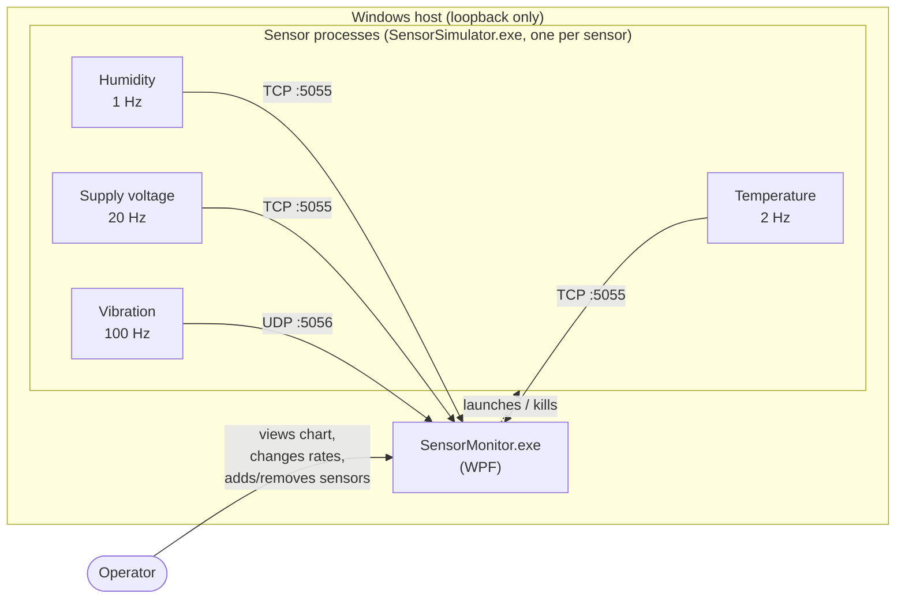

| Actor | Responsibility |
|---|---|
| **SensorMonitor** | Listens on TCP 5055 and UDP 5056, launches sensor processes, assigns sensor ids, sends commands, buffers samples, normalises and draws them. |
| **SensorSimulator** | One process = one sensor. Generates a realistic signal, timestamps it, and streams it over TCP or UDP. Obeys Start / Stop / SetRate / Shutdown. |
| **Operator** | Starts/stops streaming, adds/removes sensors, changes rates, picks normalisation and time alignment. |

By default the monitor launches four sensors on startup. Which templates go over UDP is
configured in `MainViewModel.UdpTemplates` (default: `vibration`). Sensors can also be started
by hand from a terminal and they appear in the monitor the same way.

---

## 3. Solution structure

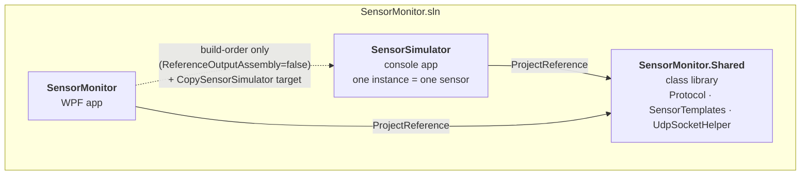

- **`SensorMonitor.Shared`** holds everything both sides must agree on: message types,
  framing, encode/decode, sensor templates, and the Windows UDP workaround. Putting the
  protocol in one library makes it impossible for the two programs to drift apart.
- **`SensorSimulator`** has no reference to the WPF app. It only knows the protocol.
- **`SensorMonitor`** references the simulator *only for build order*. A custom MSBuild
  target (`CopySensorSimulator`) copies the simulator's output next to `SensorMonitor.exe`,
  so F5 works with no manual steps.
- **`Directory.Build.props`** sets the target framework (`SensorTfm`), nullable, implicit
  usings and language version once for all three projects.

---

## 4. Monitor architecture

The WPF app is layered so that each layer only knows about the one below it.

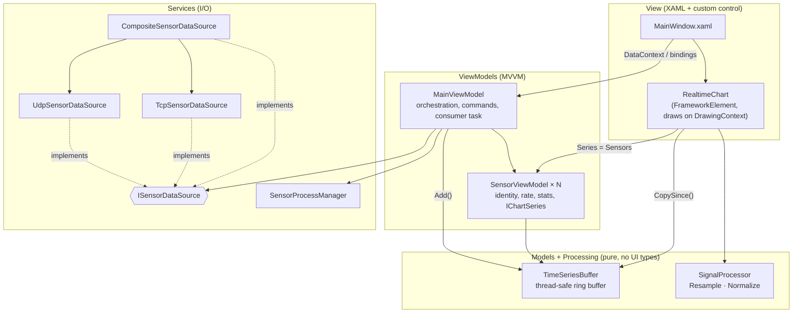

### Key types

| Type | Layer | Role |
|---|---|---|
| `ISensorDataSource` | Services | The only thing the UI knows about data input: a `ChannelReader<SensorReading>`, `SensorConnected`/`SensorDisconnected` events, and commands (`SetStreaming`, `SetRate`, `Shutdown`, `GetLinkStatus`). |
| `TcpSensorDataSource` | Services | TCP server. One accept loop, one task per connection, writes decoded samples into its channel. |
| `UdpSensorDataSource` | Services | One UDP socket for all UDP sensors. Tells senders apart by endpoint. Handles registration, liveness, sequence numbers and loss statistics. |
| `CompositeSensorDataSource` | Services | Merges any number of sources into one channel and routes commands to whichever source owns a sensor id. |
| `SensorIds` | Services | Global `Interlocked` counter so ids are unique across transports. |
| `SensorProcessManager` | Services | Starts `SensorSimulator.exe` with the right arguments; kills stragglers on shutdown. |
| `MainViewModel` | ViewModels | Composition root (default ctor builds the real sources). Owns the consumer task, the 4 Hz stats timer, commands and all chart options. |
| `SensorViewModel` | ViewModels | One card in the UI. Holds the sensor's `TimeSeriesBuffer` (30,000 samples) and implements `IChartSeries`. |
| `TimeSeriesBuffer` | Models | Fixed-capacity ring buffer, struct-of-arrays (`long[]` ticks, `double[]` values), guarded by a lock. |
| `SignalProcessor` | Processing | Stateless functions: `Resample` (time alignment) and `Normalize` (value scaling). |
| `RealtimeChart` | Controls | Custom control redrawn once per WPF frame via `CompositionTarget.Rendering`. |

**Dependency rule:** `Processing` and `Models` have no WPF or socket types, so they can be
unit-tested on their own. `RealtimeChart` depends only on the `IChartSeries` interface, not on
`SensorViewModel`.

---

## 5. Data flow: from sensor to pixel

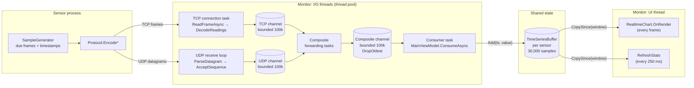

Step by step:

1. **Generate.** The simulator's 10 ms timer asks `SampleGenerator` for every frame that came due
   since the last tick. Each frame gets a UTC timestamp (with jitter); ~1 % are dropped at source.
2. **Send.** The batch is encoded as one `Readings` frame (TCP) or split into
   `SequencedReadings` datagrams of ≤ 64 samples (UDP).
3. **Receive and decode.** A per-connection task (TCP) or the single receive loop (UDP) decodes
   samples and tags each one with the monitor-assigned sensor id → `SensorReading`.
4. **Merge.** `CompositeSensorDataSource` forwards both transport channels into one.
5. **Consume.** One background task drains the channel and appends to the matching sensor's
   `TimeSeriesBuffer`. Readings for unknown ids are dropped.
6. **Render.** Every frame, the chart copies the visible window out of each buffer, resamples,
   normalises, decimates, and draws.

The UI never touches sockets, and the I/O threads never touch WPF objects. The only shared
mutable state is the ring buffers (lock-protected) and a few counters (`Interlocked`).

---

## 6. Threading model

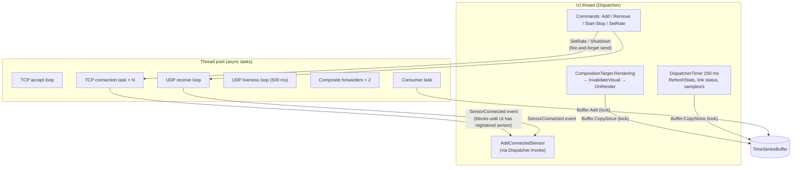

| Concern | How it is handled |
|---|---|
| **UI-thread affinity** | Data-source events fire on pool threads. `MainViewModel` marshals them with `Dispatcher.Invoke` (connect) / `InvokeAsync` (disconnect). |
| **No lost first samples** | On connect, `Dispatcher.Invoke` is *synchronous*: the sensor is registered in `_byId` before the transport sends `Start`, so the consumer never sees readings for an unknown id. |
| **Buffer contention** | `TimeSeriesBuffer` uses a single `lock`. Writers append one sample; readers copy only the visible tail (scanning backwards), so the lock is held briefly. |
| **TCP write interleaving** | Each `SensorConnection` serialises writes with a `SemaphoreSlim(1,1)`, so two commands never interleave bytes on the wire. |
| **Cross-thread fields** | Counters use `Interlocked`; flags and rates use `volatile` / `Volatile.Read/Write`. |
| **Backpressure** | All channels are bounded (100,000) with `DropOldest`. If the UI stalls, the oldest unread samples are discarded instead of growing memory without limit. |
| **Shutdown** | A `CancellationTokenSource` per component; `Dispose` cancels, closes sockets, and completes channel writers. |

---

## 7. Wire protocol

One framing format is used for both transports, defined in `SensorMonitor.Shared/Protocol.cs`.

```
 0               4    5                                   5 + length
 ├───────────────┼────┼─────────────────────────────────────┤
 │ length int32  │type│ payload (length bytes)              │
 │ little-endian │byte│                                     │
 └───────────────┴────┴─────────────────────────────────────┘
```

- **TCP** is a byte stream, so the reader uses `length` to find where each frame ends
  (`ReadExactly` 5 header bytes, then `length` payload bytes).
- **UDP** keeps datagram boundaries, so each datagram carries exactly one frame; `length`
  is only a consistency check.
- Payloads are capped at 1 MiB (`MaxPayloadSize`) to reject garbage early.

### Message overview

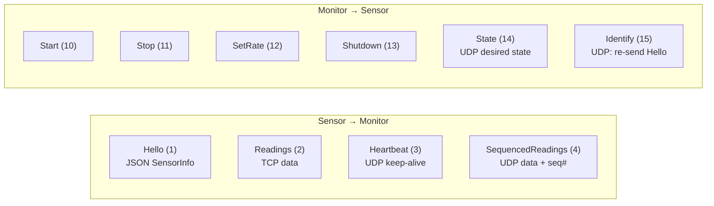

| Payload | Layout |
|---|---|
| Hello | UTF-8 JSON `{ Name, Unit, NominalMin, NominalMax, SampleRateHz, ProcessId }` |
| Readings | `int32 count` + `count × (int64 utcTicks, float64 value)` (16 bytes per sample) |
| SequencedReadings | `uint32 sequence` + same body as Readings (≤ 64 samples ≈ 1 KB, below MTU) |
| Heartbeat / State | `byte streaming` + `float64 rateHz` |
| SetRate | `float64 rateHz` |
| Start / Stop / Shutdown / Identify | empty |

**Why binary samples but JSON Hello?** Samples are high-volume and fixed-shape, so a 16-byte
binary layout is compact and allocation-free to decode. Hello is sent once, is easy to extend,
and benefits from being readable.

**Why enum values with gaps (1–4, 10–15)?** Sensor-to-monitor and monitor-to-sensor messages are
in separate ranges, so the direction is visible from the number. The values are part of the
protocol and must not be renumbered.

---

## 8. TCP transport

TCP provides connection setup, reliable ordered delivery, and disconnect detection, so the TCP
path is the simple one.

### Session sequence

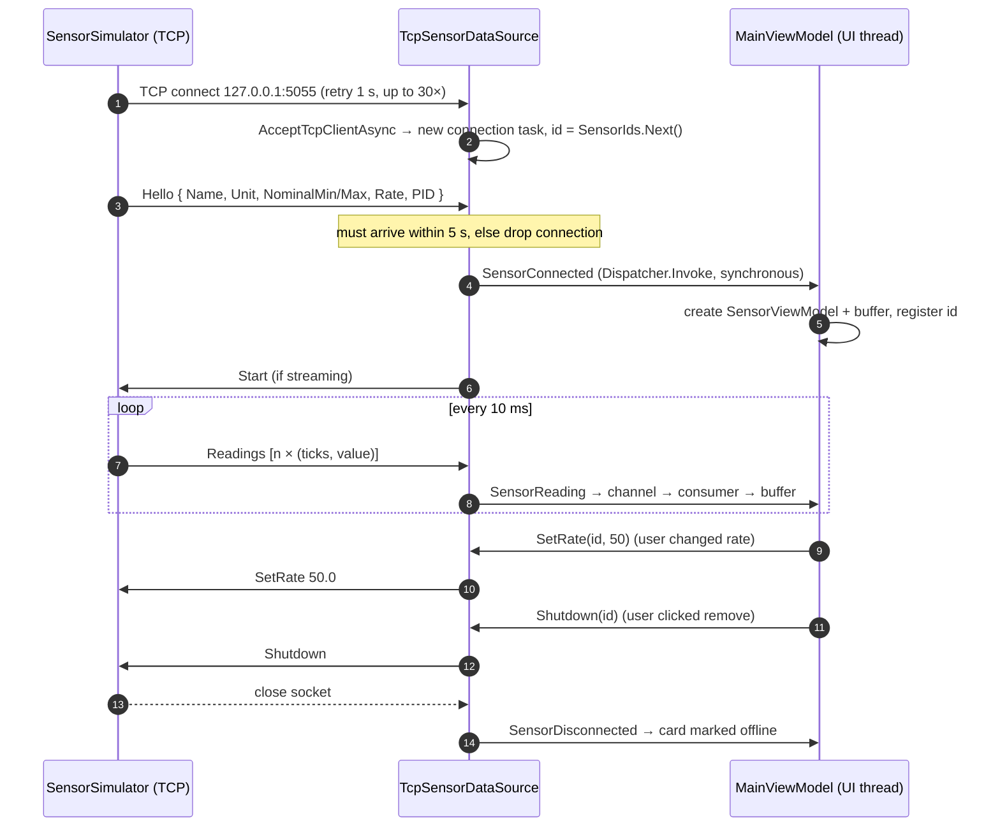

### Simulator side

`TcpSensorClient` runs two loops concurrently after the handshake:

- **Sampling loop**: 10 ms `PeriodicTimer` → `SampleGenerator.Generate` → one `Readings` frame.
- **Command loop**: reads frames and applies Start / Stop / SetRate; returns on Shutdown or EOF.

Whichever finishes first ends the session (`Task.WhenAny`), then the other is cancelled.

---

## 9. UDP transport

UDP has no connections, no delivery guarantee and no ordering. Each TCP feature the app
relies on is rebuilt on top of datagrams:

| TCP gives us | UDP replacement |
|---|---|
| Connect / handshake | `Hello` resent every second until the monitor answers with `State` |
| "Is the other side alive?" | `Heartbeat` every second; monitor marks a sensor offline after **3 s** of silence; sensor exits after **5 s** of silence from the monitor |
| Reliable commands | `State` (full desired state: streaming + rate) sent in reply to **every** heartbeat; a lost command is corrected within ~1 s |
| Ordered, lossless data | `uint32` sequence number per datagram; gaps counted as *lost*, older-than-newest counted as *late* and dropped |
| Message boundaries | One frame per datagram, ≤ 64 samples so datagrams never fragment |
| Peer forgot me | Monitor answers unknown senders with `Identify`; sensor re-sends `Hello` |

### Registration, steady state and recovery

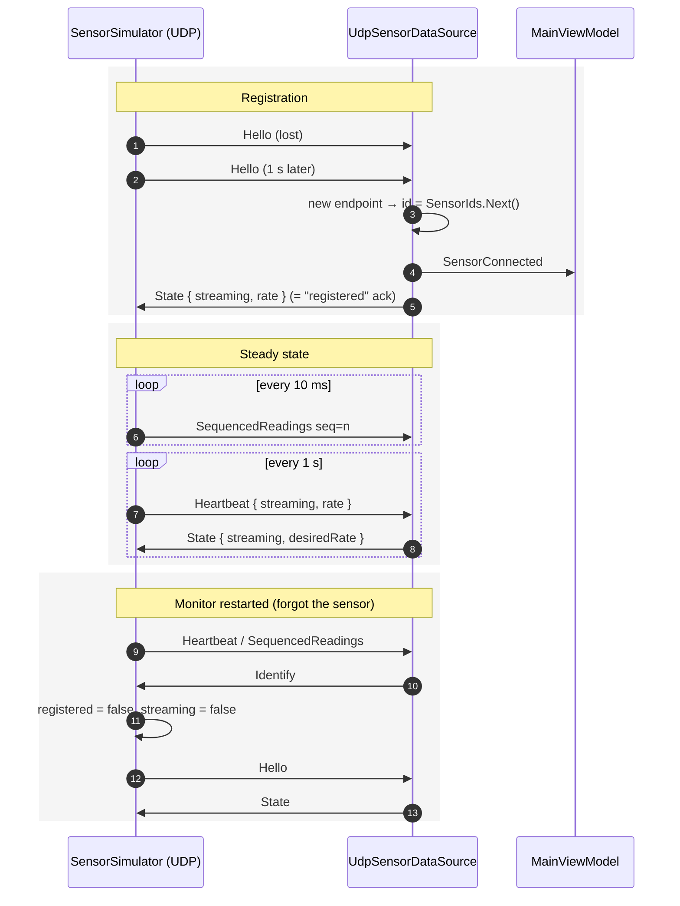

### Sequence-number accounting

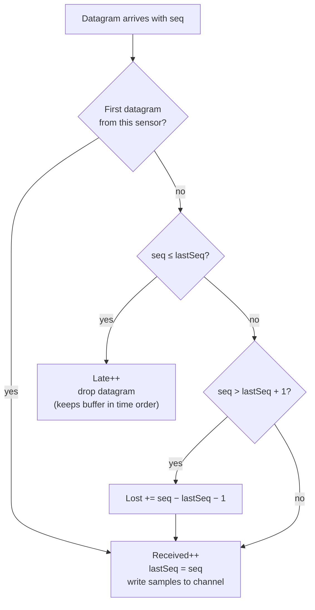

The card shows `UDP · <lost> lost (<pct>%) · <late> late`. "Lost" means "not shown": datagrams
that never arrived. Late ones were received but discarded, because the ring buffer and chart
assume samples arrive in time order.

### Shutdown on UDP

There is no socket close to observe, so shutdown is explicit and idempotent:

- `Shutdown(id)` removes the sensor and **remembers its endpoint for 30 s**. Any further
  datagram from that endpoint gets another `Shutdown`, so a lost Shutdown can't turn the
  sensor into a "new" sensor.
- On monitor exit, `Dispose` sends `Shutdown` synchronously to all UDP sensors. If one is lost,
  the sensor exits by itself after 5 s without hearing from the monitor.

### Windows quirk

When a UDP send hits a closed port, Windows reports the ICMP "port unreachable" as a
`ConnectionReset` on the *next receive*, which would kill a naive receive loop.
`UdpSocketHelper.IgnoreConnectionResets` disables this with `SIO_UDP_CONNRESET`, and the
receive loops also catch and ignore it.

---

## 10. Sensor lifecycle

### As seen by the monitor

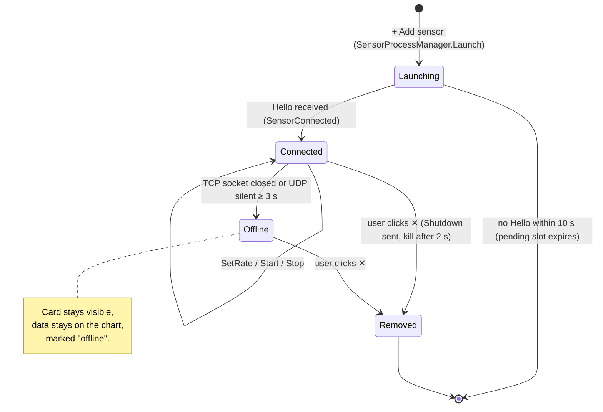

- A **pending launch** reserves one of the 8 slots (`MaxSensors`) for up to 10 s so rapid clicks
  can't overshoot the limit.
- If a sensor connects while 8 are already present (e.g. started by hand), it is sent
  `Shutdown` and rejected.
- **Offline sensors are not reconnected.** A sensor that comes back gets a new id and a new card.
  This keeps id → buffer mapping simple and avoids mixing data from two sessions.

### As seen by the UDP simulator

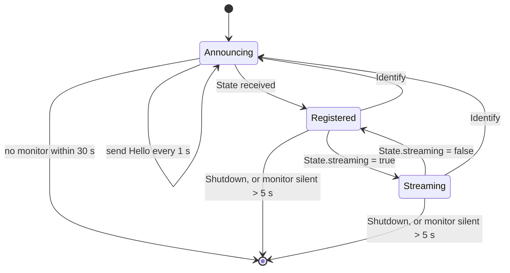

### Process management

`SensorProcessManager` starts `SensorSimulator.exe` (or `dotnet SensorSimulator.dll` as a
fallback) from the monitor's own folder with `--template --name --rate --transport --port`.
Processes are hidden unless **Show console window for new sensors** is ticked.
Cleanup is layered so that no orphan processes are left behind:

1. Graceful: closing sockets (TCP) or sending `Shutdown` (UDP) makes the sensor exit by itself.
2. Removal fallback: 2 s after the user removes a sensor, its PID is killed if still alive.
3. App exit fallback: `Dispose` waits up to 1.5 s in total, then kills remaining processes
   (`entireProcessTree: true`).

---

## 11. Signal processing

Sensors differ in two ways that make a shared chart hard: **units/ranges** and **sample rates**.
`SignalProcessor` addresses each with a separate, pure step. The chart runs them per series,
per frame:

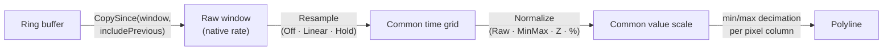

### 11.1 Time alignment (`Resample`)

The grid is aligned to **absolute time** (multiples of `1/rate` in ticks), so every sensor
gets exactly the same timestamps no matter when it started.

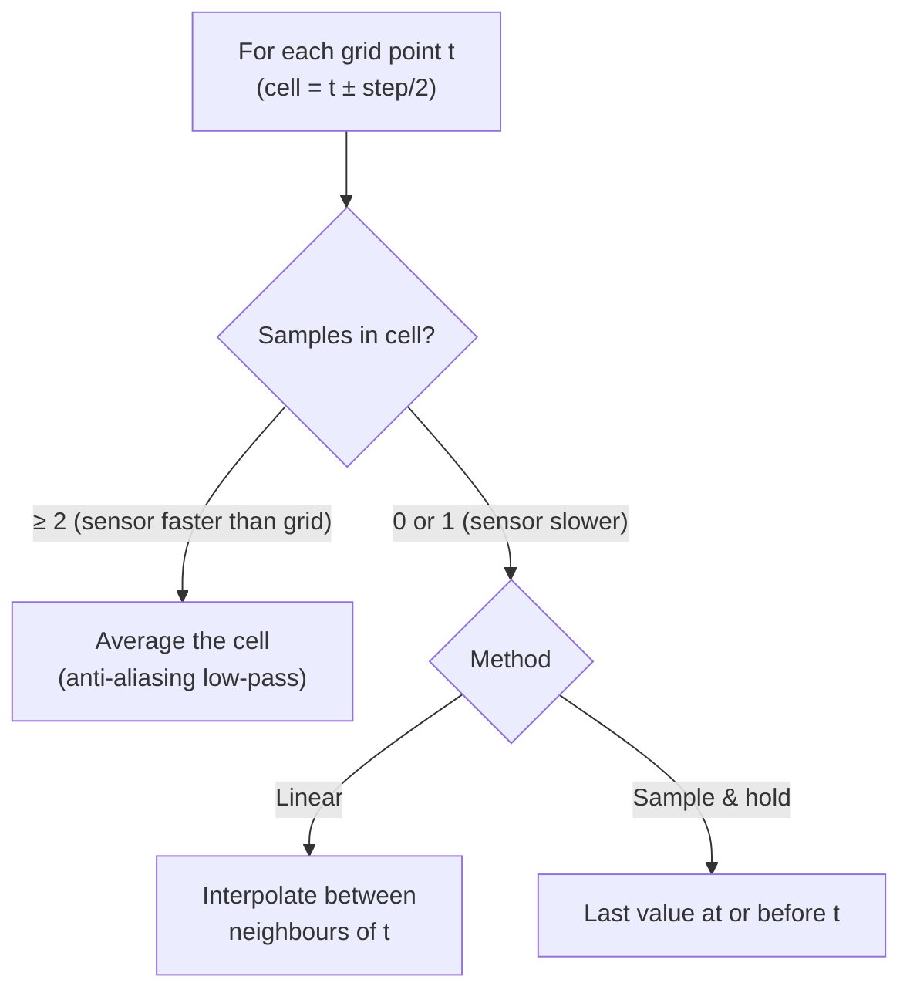

- **Linear** stops at the newest sample: it can't interpolate into the future.
- **Sample & hold** extends the last value up to "now", so slow sensors don't appear to lag.
- **Off** passes samples through unchanged.

Averaging when downsampling matters: picking one 100 Hz vibration sample per 10 Hz cell would
alias high-frequency content into false low-frequency wiggles.

### 11.2 Value scaling (`Normalize`)

| Mode | Formula | Y axis | When to use |
|---|---|---|---|
| Raw | `v` | engineering units | One sensor, or split view |
| **Min–max** (default) | `(v − min) / (max − min)` over the visible window | fixed −0.08…1.08 | Comparing shapes |
| Z-score | `(v − mean) / σ` over the visible window | σ, at least ±2 | Spotting outliers/spikes |
| % of nominal | `(v − nomMin) / (nomMax − nomMin) × 100` | %, at least 0…100 | "How close to its limits?" |

Window-based modes (min–max, z-score) adapt as data scrolls. Nominal ranges come from each
sensor's `Hello`, so the monitor needs no per-sensor configuration. Degenerate cases (flat
signal, zero span) map to the mid-point / zero instead of dividing by zero.

---

## 12. Rendering

`RealtimeChart` is a `FrameworkElement` that draws directly to a `DrawingContext`. There are no
per-point WPF objects, shapes or bindings, so the cost stays independent of the visual tree.

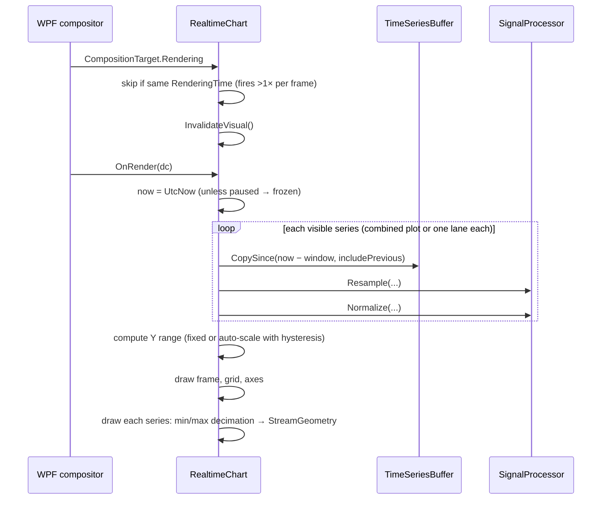

Techniques that keep it fast and stable:

- **Reused buffers.** `_raw` and a pool of `List<DataPoint>` are reused every frame. No
  per-frame allocations beyond geometry.
- **Min/max decimation.** When there are more points than pixels, each pixel column draws only
  its min and max (≤ ~2 points per column). Peaks and spikes stay visible, unlike naive
  every-Nth sampling.
- **Auto-scale with hysteresis.** The range expands immediately when data leaves it and
  shrinks by 5 % per frame toward the target, so the axis doesn't jitter.
- **`includePrevious`.** One sample before the window's left edge is included so lines enter
  cleanly from the edge instead of starting mid-plot.
- **Split view** draws one lane per sensor (falls back to combined if lanes would be < 40 px).
- **Pause** freezes "now" so the chart can be inspected while data keeps arriving.

---

## 13. Sensor simulator

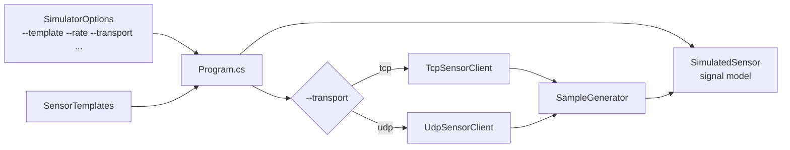

- **`SimulatedSensor`** produces a believable signal:
  `base + A·sin(ωt+φ) + 0.25A·sin(2.7ωt) + drift + noise + rare spikes`, where drift is a
  mean-reverting random walk and noise is Gaussian (Box–Muller). Each template
  (`SensorTemplates`) sets base, amplitude, period, noise, default rate and nominal range.
- **`SampleGenerator`** is shared by both transports so they produce identical data. Windows
  timers tick at ~15 ms, so each call emits *every frame that came due* since the last call,
  with ±15 % timing jitter and 1 % dropped frames. Timestamps are kept strictly increasing.
  It refuses to build a backlog while paused or after a long stall (> 1 s), to avoid bursts.
- The seed defaults to the process id, so each instance has a different but reproducible signal
  (`--seed` to pin it).

---

## 14. Error handling and resilience

| Failure | Detection | Behaviour |
|---|---|---|
| Port already in use | `SocketException` from `Start()` | Status line shows the error; no sensors are launched. |
| Simulator exe missing | File check in `SensorProcessManager` | Status line asks to rebuild. |
| Sensor crashes / is killed | TCP: read returns 0 or `IOException`. UDP: 3 s of silence | Card marked offline, data kept. |
| Sensor sends garbage | `InvalidDataException` / `JsonException` | TCP: that connection is closed. UDP: only that datagram is dropped. |
| No Hello within 5 s (TCP) | Linked timeout token | Connection dropped. |
| Monitor not up yet | TCP connect fails / no UDP reply | TCP retries 30 × 1 s; UDP announces for 30 s, then exits. |
| Monitor exits | TCP EOF; UDP `Shutdown` or 5 s silence | Every sensor process exits on its own; leftovers are killed. |
| Monitor restarts (UDP) | Unknown endpoint sends data | Monitor replies `Identify`; sensor re-registers. |
| UI can't keep up | Bounded channels | Oldest samples dropped (`DropOldest`); memory stays bounded. |
| Timestamp out of range | Range check before `new DateTime(ticks)` | Sample skipped. |
| ICMP port unreachable (Windows UDP) | `SocketError.ConnectionReset` | Ignored (`SIO_UDP_CONNRESET` + catch). |

The general rule: **a misbehaving sensor can only affect itself.** Exceptions are caught at the
boundary of the connection or datagram that caused them, and only expected exception types are
caught.

---

## 15. Performance and capacity

| Parameter | Value | Where |
|---|---|---|
| Max sensors | 8 | `MainViewModel.MaxSensors` |
| Sample rate per sensor | 1–100 Hz (UI), 0.1–1000 Hz (simulator clamp) | `SensorTemplates.AvailableRates`, `SimulatedSensor.RateHz` |
| Buffer per sensor | 30,000 samples × 16 B ≈ 470 KB (5 min at 100 Hz) | `SensorViewModel.Buffer` |
| Visible window | 5–120 s | `MainViewModel.TimeWindowSeconds` |
| Channel capacity | 100,000 readings each | data sources |
| UDP datagram | ≤ 64 samples ≈ 1 KB | `Protocol.MaxSamplesPerDatagram` |
| Stats refresh | 4 Hz | `MainViewModel._statsTimer` |
| Chart redraw | once per WPF frame (typically 60 Hz) | `RealtimeChart.OnRendering` |

Worst case at 8 × 100 Hz × 120 s window ≈ 96,000 points copied per frame; decimation then
limits what is actually drawn to about 2 × plot width per series.

---

## 16. Extension points

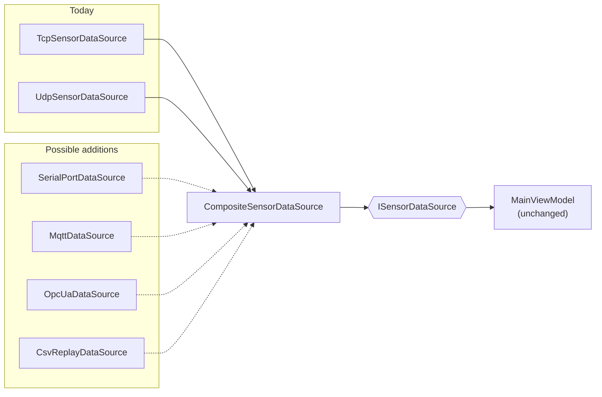

1. **New device that speaks the protocol.** Implement the framing from §7 on the device or in
   a small bridge. Nothing in the monitor changes.
2. **New transport.** Implement `ISensorDataSource` (channel + events + commands), get ids from
   `SensorIds.Next()`, and add it to the `CompositeSensorDataSource` in `MainViewModel`'s
   default constructor.
3. **New sensor type.** Add a row to `SensorTemplates.All`.
4. **New normalisation / alignment mode.** Add an enum value and a case in `SignalProcessor`, and
   an `Option` entry in `MainViewModel`. The chart picks it up automatically.

---

## 17. Design decisions

| # | Decision | Alternatives considered | Rationale |
|---|---|---|---|
| D1 | **One OS process per sensor** | Threads/tasks in the monitor | Real isolation: a crash, hang or GC pause in one sensor can't affect others; exercises real networking; mirrors real devices. |
| D2 | **Monitor is the server** | Sensors as servers, monitor connects | Sensors can come and go without configuration; the monitor needs no list of addresses. |
| D3 | **Loopback only** | Bind to all interfaces | No firewall prompt and no attack surface. The protocol has no authentication. |
| D4 | **Monitor assigns ids** | Sensor-chosen ids | Avoids collisions; a reconnecting sensor never mixes data with an old session. |
| D5 | **Length-prefixed binary frames** | Newline-delimited JSON, protobuf | Zero dependencies, compact, cheap to decode, and works for both TCP and UDP. |
| D6 | **UDP commands as idempotent state** | Acks + retransmit per command | Simpler and self-healing: the latest `State` always wins, and loss is fixed by the next heartbeat. |
| D7 | **Drop late UDP datagrams** | Reorder buffer | The ring buffer and chart rely on time order; late data is rare and only cosmetic. |
| D8 | **`System.Threading.Channels`, bounded, DropOldest** | `BlockingCollection`, unbounded queue, `ConcurrentQueue` | Async-friendly, fast, and keeps memory bounded. For live monitoring, fresh data matters more than old data. |
| D9 | **Ring buffer, struct-of-arrays, one lock** | `ConcurrentQueue`, lock-free | Fixed memory, cache-friendly copies, trivially correct. Contention is low (one writer, short reads). |
| D10 | **Custom `DrawingContext` chart** | Third-party chart library, WPF `Polyline` shapes | No dependencies; full control over decimation and per-frame cost. |
| D11 | **Processing as pure static functions** | Stateful pipeline objects | Easy to reason about and unit-test; no UI or threading concerns. |
| D12 | **Keep offline sensors on screen** | Remove on disconnect | The operator can still see what happened just before a sensor dropped out. |

---

## 18. Known limitations and future work

- **No clock sync.** Timestamps come from each sensor's clock. This is fine on one machine, but
  sensors on other hosts would need NTP/PTP or monitor-side timestamping.
- **No security.** Anyone on the local machine can connect. Before exposing it on a network, add
  authentication and TLS/DTLS, and bind explicitly.
- **No persistence or export.** Data is lost on exit; CSV export or a recording mode would be a
  natural addition.
- **No reconnection identity.** A returning sensor gets a new card. Matching by name or a
  persistent device id would let it resume its old card.
- **No automated tests yet.** `SignalProcessor`, `TimeSeriesBuffer`, `Protocol` encode/decode and
  `UdpSensor.AcceptSequence` are pure and ready for a unit-test project.
- **Late UDP data is discarded** rather than inserted in order; a small reorder window would
  recover it at the cost of latency.
- **Windows only** for the monitor (WPF). The shared library and simulator already build
  cross-platform.
